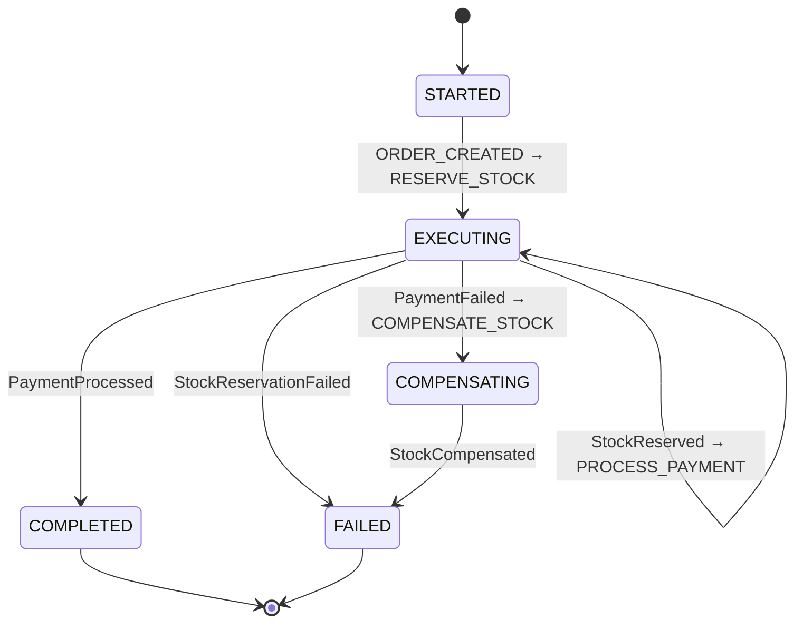
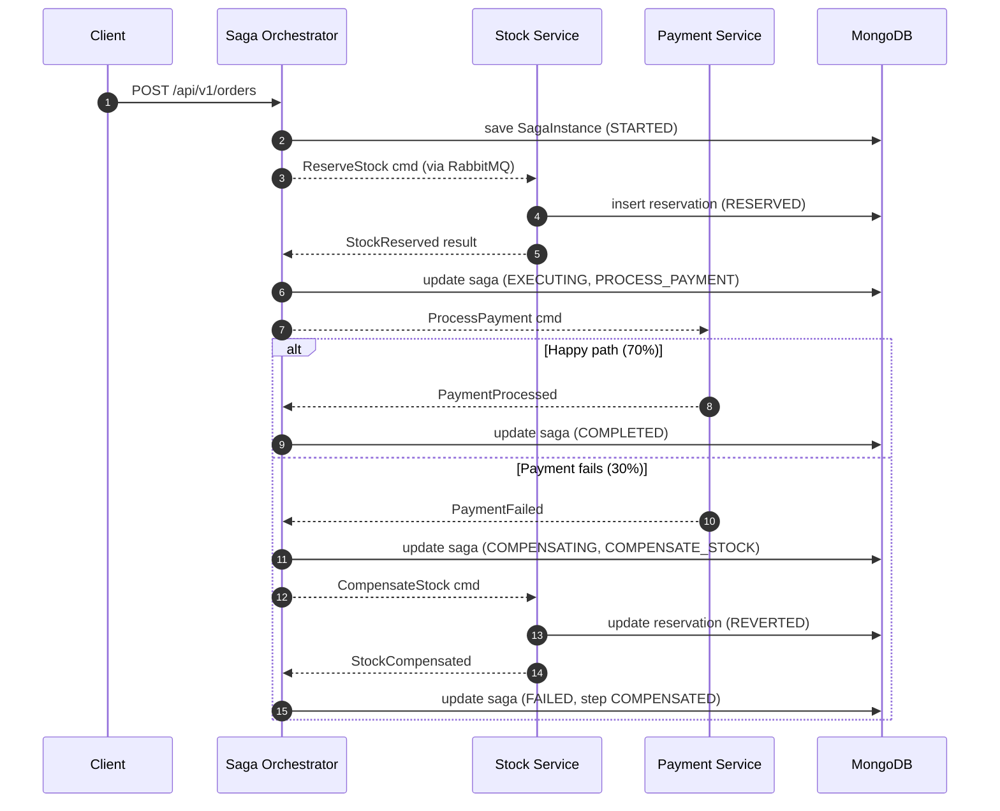

# saga-orchestration-compensating-transaction

A minimalist, production-ready implementation of the **Saga Orchestration Pattern** using Java 21, Spring Boot 3, RabbitMQ, and MongoDB to manage distributed transactions and automatic rollbacks.

The focus is a single hard problem: **what do you do when step N of a multi-service workflow succeeds, but step N+1 fails?** In a monolith you'd roll back the transaction. In a distributed system there is no transaction — so you undo the already-committed effects of earlier steps with **compensating transactions**.

## Saga State Machine



## Happy path vs. rollback path



### Rollback scenario — step by step

Say a customer places an order, but the payment is declined (insufficient funds, card error, 3DS cancelled). The sequence of events:

1. `POST /api/v1/orders` — `OrderController` accepts the request and invokes `SagaOrchestrator.startOrderSaga()`.
2. The orchestrator creates a new `SagaInstance` (`STARTED`, step: `RESERVE_STOCK`), persists it to MongoDB, and dispatches a `stock.reserve` command via RabbitMQ.
3. `StockService` consumes the command, opens a reservation `RES-XXXXXXXX` (`RESERVED`) in Mongo, and publishes a `stock.reserved` result event.
4. The orchestrator consumes the result: the saga transitions to `EXECUTING` + `PROCESS_PAYMENT`, and a `payment.process` command is dispatched.
5. `PaymentService` receives the command — in this POC it uses `saga.simulation.payment-failure-rate` (default 0.30) to randomly succeed or fail. Suppose it `DECLINED` this time; it publishes a `payment.failed` result event.
6. The orchestrator consumes the result: the saga enters `COMPENSATING`, the step moves to `COMPENSATE_STOCK`, and a `stock.compensate` command is dispatched (with the reservation ID attached).
7. `StockService` consumes the command, marks the reservation as `REVERTED` in Mongo, and publishes a `stock.compensated` event.
8. The orchestrator consumes the result: a `COMPENSATED` record is appended to the step history, and the saga enters its terminal `FAILED` state.

End state in MongoDB:
- `saga_instances` — saga document, `status: FAILED`, full step history (successes + failure + compensation).
- `stock_reservations` — reservation marked `REVERTED`; every reserve/revert is auditable.
- `payment_attempts` — the payment attempt remains as `DECLINED`.

Nothing is "lost". Every step's commit and its rollback are audit-logged.

## Technology Stack

| Layer | Choice |
| --- | --- |
| Language | Java 21 |
| Framework | Spring Boot 3.3 |
| State store | MongoDB 7 (saga_instances + domain collections) |
| Messaging | RabbitMQ 3.13 (topic exchange, async commands + results) |
| API docs | SpringDoc OpenAPI → Swagger UI |
| Metrics | Micrometer + Prometheus |
| Tests | JUnit 5 + Testcontainers + Awaitility |

## Running

One command:

```bash
docker-compose up --build
```

That starts MongoDB, RabbitMQ and the application.

| Service | URL |
| --- | --- |
| API | http://localhost:8080 |
| Swagger UI | http://localhost:8080/swagger-ui.html |
| Actuator | http://localhost:8080/actuator |
| RabbitMQ UI | http://localhost:15672 (saga/saga) |

### Local development without Docker

```bash
docker-compose up -d mongo rabbitmq
./mvnw spring-boot:run
```

### Tests

```bash
./mvnw test
```

### Quick try

```bash
curl -X POST http://localhost:8080/api/v1/orders \
  -H "Content-Type: application/json" \
  -d '{
    "orderId": "ORDER-001",
    "customerId": "CUST-42",
    "sku": "SKU-TSHIRT-BLACK-L",
    "quantity": 2,
    "amountMinor": 25000,
    "currency": "TRY"
  }'
```

The response contains a `correlationId`. After a few seconds:

```bash
curl http://localhost:8080/api/v1/orders/sagas/<correlationId>
```

The status will be either `COMPLETED` or `FAILED`; the `history` field records every step's success/failure/compensation. POST 10-20 times — roughly 30% will fail and trigger a compensation.

## Project Layout

```
src/main/java/com/ruvi/saga/
├── api/                       REST + validation + exception handler
├── application/
│   ├── orchestrator/          SagaOrchestrator — state machine, @RabbitListener on results
│   └── steps/                 StockService, PaymentService — @RabbitListener on commands
├── domain/
│   ├── saga/                  SagaInstance, SagaStatus, SagaStep, StepStatus, SagaStepRecord
│   └── events/                SagaCommand, SagaResult (JSON over AMQP)
└── infrastructure/
    ├── config/                RabbitMqConfig, OpenApiConfig
    ├── messaging/             CommandPublisher, ResultPublisher
    └── persistence/           SagaInstanceRepository (Mongo)
```

## Design decisions

**Orchestration, not choreography.** In choreography each service listens for the next service's event; the workflow is never written down, it only emerges. In a three-step workflow, "which event triggers which" becomes a wiki-plus-grep tournament during the next incident. In orchestration the state lives in one place (`SagaOrchestrator` + the `saga_instances` collection), the workflow reads as code, and adding a new step is just one more `onX / dispatch` pair.

**Async messaging, not sync HTTP.** `OrderController` returns `202 Accepted` plus the current saga state, and the orchestrator and step services communicate only over RabbitMQ afterwards. With sync HTTP, Payment Service being down would break the whole flow; with RabbitMQ, Payment Service can go down and come back five minutes later — the command sits in the queue and is processed when the service recovers.

**State machine inside `SagaInstance`.** The `SagaStep` enum is a node, `SagaStatus` is the overall state, and the `history` list is the audit trail. No separate state-machine library (e.g. Spring State Machine) is used because the framework overhead hurts readability for a three-step workflow — a switch/case plus status transitions is enough and far easier to test.

**MongoDB optimistic locking.** `SagaInstance` carries `@Version`; if two result events for the same saga arrive at once, the second gets an `OptimisticLockingFailureException` and is retried (RabbitMQ retry policy is enabled). The "lost update" window is closed.

**Simulated failure rate.** `PaymentService` doesn't call a real payment gateway — it randomly declines according to `saga.simulation.payment-failure-rate` (default 30%). This way 10-20 POSTs are enough to see the compensation path exercise itself live.
