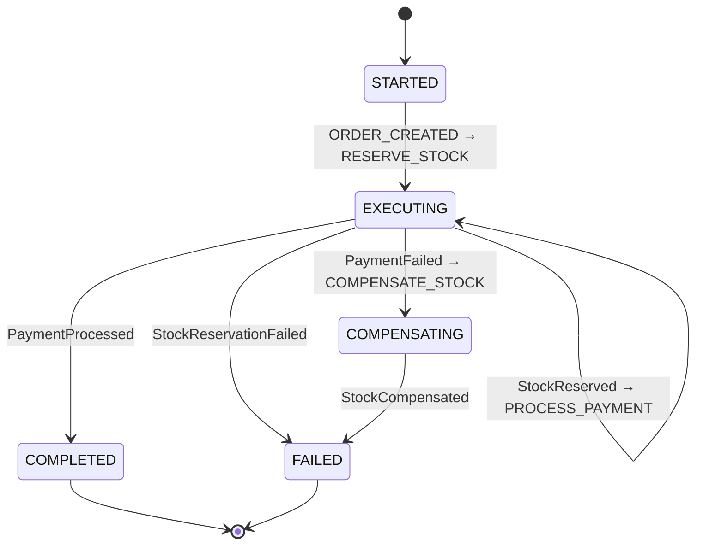
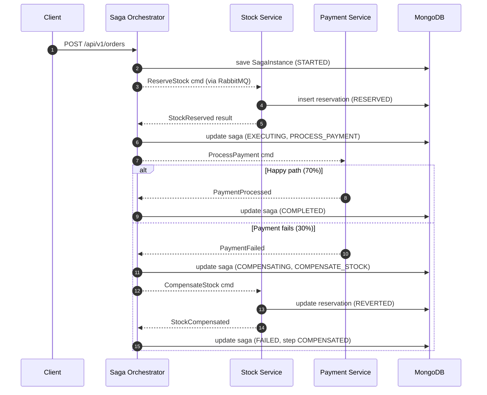

# saga-orchestration-compensating-transaction

A minimalist, production-ready implementation of the **Saga Orchestration Pattern** using Java 21, Spring Boot 3, RabbitMQ, and MongoDB to manage distributed transactions and automatic rollbacks.

The focus is a single hard problem: **what do you do when step N of a multi-service workflow succeeds, but step N+1 fails?** In a monolith you'd roll back the transaction. In a distributed system there is no transaction — so you undo the already-committed effects of earlier steps with **compensating transactions**.

## Saga State Machine



## Happy path vs. rollback path



### Rollback senaryosu — adım adım

Diyelim ki müşteri bir ürün sipariş etti ama ödeme reddedildi (yetersiz bakiye, kart hatası, 3DS iptal). Olaylar sırayla:

1. `POST /api/v1/orders` → `OrderController` isteği kabul eder, `SagaOrchestrator.startOrderSaga()` çağrılır.
2. Orchestrator yeni bir `SagaInstance` yaratır (`STARTED`, step: `RESERVE_STOCK`), MongoDB'ye kaydeder, Rabbit üzerinden `stock.reserve` komutunu yollar.
3. `StockService` dinler, Mongo'ya `RES-XXXXXXXX` ID'li reservation (`RESERVED`) açar, `stock.reserved` sonuç event'ini yayınlar.
4. Orchestrator sonucu yakalar: saga `EXECUTING` + `PROCESS_PAYMENT` adımına geçer, `payment.process` komutunu yollar.
5. `PaymentService` komutu alır — bu POC'de `saga.simulation.payment-failure-rate` (varsayılan 0.30) ile rastgele başarı/başarısızlık üretir. Diyelim bu sefer `DECLINED`. `payment.failed` sonuç event'ini yayınlar.
6. Orchestrator sonucu yakalar: saga `COMPENSATING` durumuna girer, step `COMPENSATE_STOCK`'a geçer, `stock.compensate` komutunu yollar (reservation ID ile birlikte).
7. `StockService` komutu alır, Mongo'da reservation'ı `REVERTED` olarak işaretler, `stock.compensated` event'ini yollar.
8. Orchestrator sonucu yakalar: step history'ye `COMPENSATED` kaydı eklenir, saga `FAILED` olarak terminal duruma geçer.

Sonuçta MongoDB'de:
- `saga_instances` — saga dokümanı, `status: FAILED`, tüm step geçmişi (başarılar + fail + compensation).
- `stock_reservations` — reservation `REVERTED`, kaç kez yapıldı/geri alındı audit edilebilir.
- `payment_attempts` — payment attempt `DECLINED` olarak kalır.

Hiçbir satır "kaybolmaz". Her adımın hem commit'i hem rollback'i audit-logged.

## Teknoloji Stack'i

| Katman | Seçim |
| --- | --- |
| Language | Java 21 |
| Framework | Spring Boot 3.3 |
| State store | MongoDB 7 (saga_instances + domain collections) |
| Messaging | RabbitMQ 3.13 (topic exchange, async commands + results) |
| API docs | SpringDoc OpenAPI → Swagger UI |
| Metrics | Micrometer + Prometheus |
| Tests | JUnit 5 + Testcontainers + Awaitility |

## Çalıştırma

Tek komut:

```bash
docker-compose up --build
```

Bu komutla MongoDB, RabbitMQ ve uygulama ayağa kalkar.

| Servis | URL |
| --- | --- |
| API | http://localhost:8080 |
| Swagger UI | http://localhost:8080/swagger-ui.html |
| Actuator | http://localhost:8080/actuator |
| RabbitMQ UI | http://localhost:15672 (saga/saga) |

### Local development without Docker

```bash
docker-compose up -d mongo rabbitmq
./mvnw spring-boot:run
```

### Testler

```bash
./mvnw test
```

### Hızlı deneme

```bash
curl -X POST http://localhost:8080/api/v1/orders \
  -H "Content-Type: application/json" \
  -d '{
    "orderId": "ORDER-001",
    "customerId": "CUST-42",
    "sku": "SKU-TSHIRT-BLACK-L",
    "quantity": 2,
    "amountMinor": 25000,
    "currency": "TRY"
  }'
```

Yanıt içinde `correlationId` döner. Birkaç saniye sonra:

```bash
curl http://localhost:8080/api/v1/orders/sagas/<correlationId>
```

Status `COMPLETED` ya da `FAILED` olmuş olur; `history` alanında her adımın başarı/başarısızlık/compensation kaydı görünür. 10-20 kere POST yap → yaklaşık %30'u fail eder ve compensation tetiklenir.

## Proje Yapısı

```
src/main/java/com/ruvi/saga/
├── api/                       REST + validation + exception handler
├── application/
│   ├── orchestrator/          SagaOrchestrator — state machine, @RabbitListener on results
│   └── steps/                 StockService, PaymentService — @RabbitListener on commands
├── domain/
│   ├── saga/                  SagaInstance, SagaStatus, SagaStep, StepStatus, SagaStepRecord
│   └── events/                SagaCommand, SagaResult (JSON over AMQP)
└── infrastructure/
    ├── config/                RabbitMqConfig, OpenApiConfig
    ├── messaging/             CommandPublisher, ResultPublisher
    └── persistence/           SagaInstanceRepository (Mongo)
```

## Design kararları

**Orchestration, choreography değil.** Choreography'de her servis diğerinin event'ini dinler, iş akışı yazılı değildir — sadece emergent'tır. 3 adımlık bir workflow'da hangi event hangisini tetikler, debugging gecesi "wiki + grep" turnuvasıdır. Orchestration'da state tek yerde (`SagaOrchestrator` + `saga_instances` koleksiyonu), workflow kod olarak okunur, yeni adım eklemek `onX / dispatch` çifti eklemek demektir.

**Async messaging, sync HTTP değil.** `OrderController` isteği `202 Accepted` + current saga state döner, sonra orchestrator ile step service'leri sadece RabbitMQ üzerinden konuşur. HTTP sync olsaydı Payment Service'in down olması bütün akışı patlatırdı; RabbitMQ ile Payment Service kalksın, 5 dakika sonra kalksın — command queue'da bekler, kalkınca işler.

**State makinası `SagaInstance` içinde.** `SagaStep` enum = düğüm, `SagaStatus` = genel durum, `history` listesi = audit trail. State machine implementasyonu için ayrı bir library (Spring State Machine) kullanmadık çünkü 3 adımlık bir workflow için framework overhead'i okunurluğu bozuyor — switch/case + status geçişleri yeterli ve test etmesi kolay.

**MongoDB optimistic locking.** `SagaInstance` üzerinde `@Version` var; aynı saga için iki result event aynı anda gelirse ikincisi `OptimisticLockingFailureException` alır ve retry edilir (Rabbit retry policy devrede). "Lost update" ihtimali kapanıyor.

**Simüle edilen başarısızlık oranı.** `PaymentService` gerçek bir ödeme yapmıyor — `saga.simulation.payment-failure-rate` ile rastgele reddediyor (varsayılan %30). Böylece compensation path'ini canlı görmek için 10-20 kere POST atmak yeterli.
